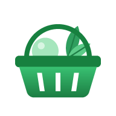
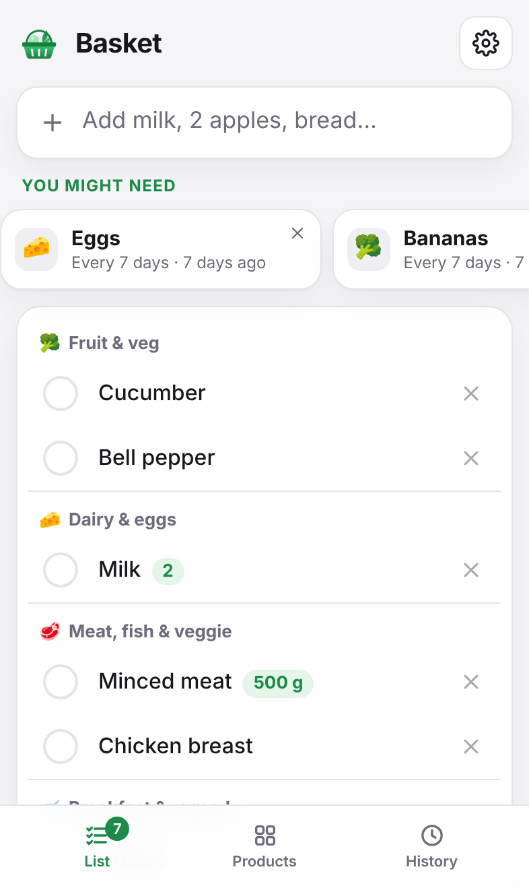
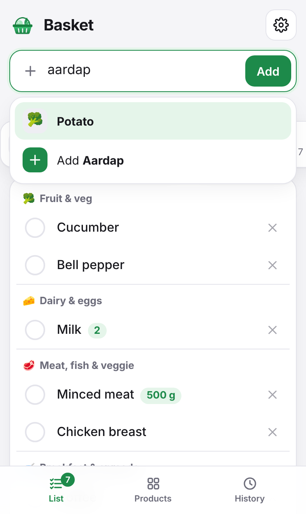
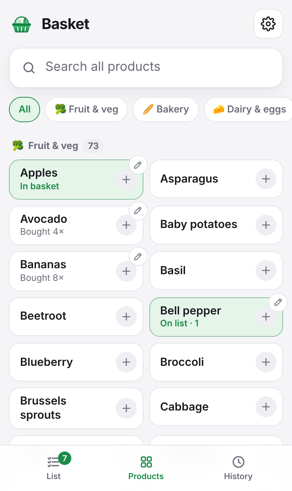
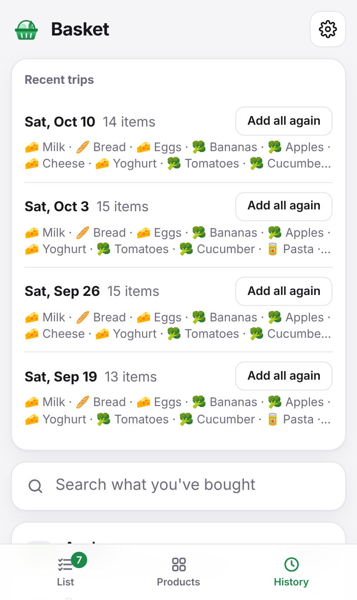
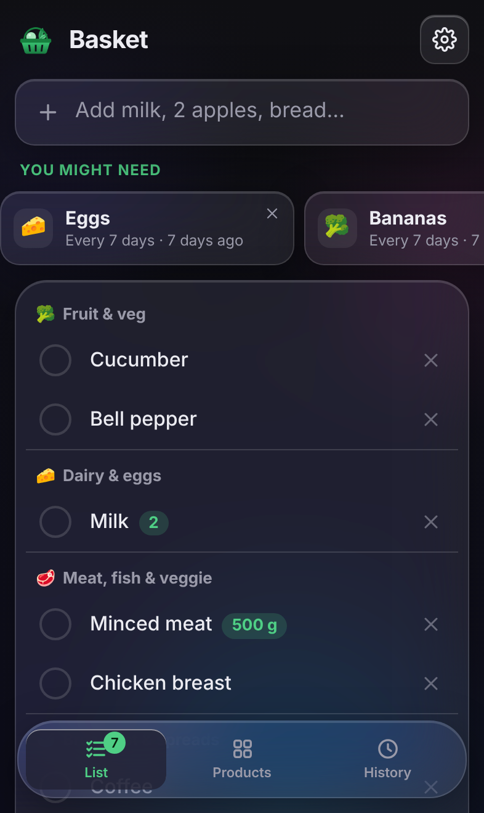
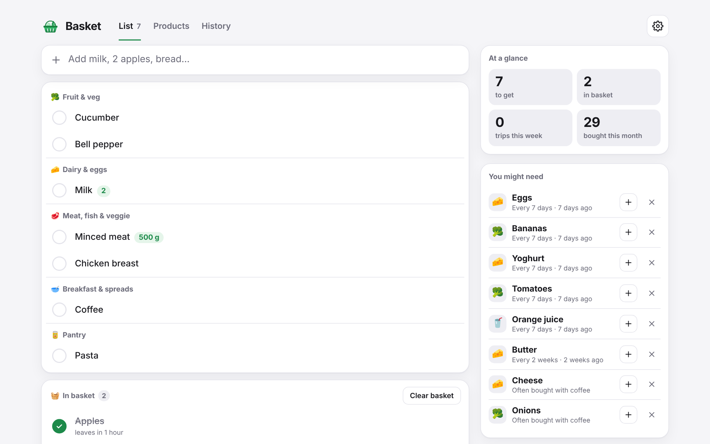
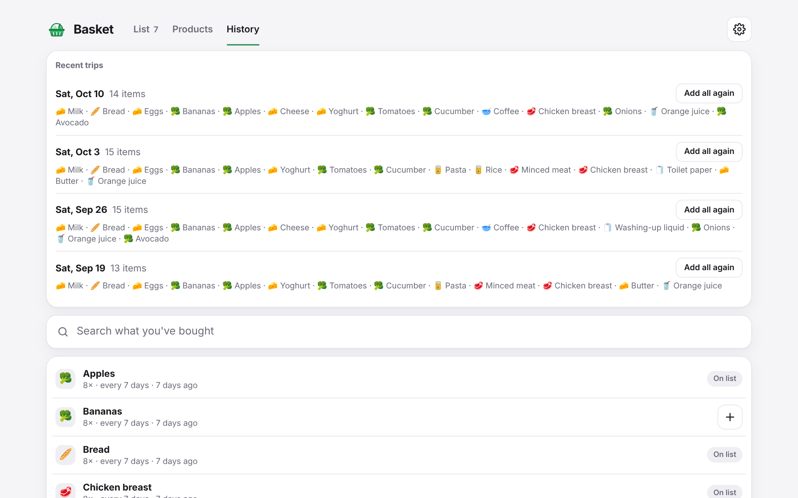

<div align="center">



# Basket

**A shared household grocery list that understands English and Dutch.**

</div>

> [!WARNING]
> **This project is entirely vibe coded.**
> I built Basket for myself, for my own grocery shopping, and it was written with an AI assistant rather than
> carefully coded by hand. I decided to put it online in case it is useful to someone else too.
>
> That means: no promise it won't break or that it will stay secure. Feel free to use it, but do so at your own risk.
> Back up your data, and expect rough edges. Issues and pull requests are welcome, but I can't promise a fast reply.

## Screenshots

<table>
  <tr>
    <td align="center"><br /><sub>The list, sorted by store section</sub></td>
    <td align="center"><br /><sub>Dutch is understood: aardap finds Potato</sub></td>
    <td align="center"><br /><sub>Products</sub></td>
  </tr>
  <tr>
    <td align="center"><br /><sub>Recent trips</sub></td>
    <td align="center"><br /><sub>Glass style, dark mode (experimental)</sub></td>
    <td></td>
  </tr>
</table>



<details>
<summary>More desktop screenshots</summary>



</details>

## Features

- **Add things quickly.** Type and press Enter. Quantities are understood too: `2 melk`, `milk x2`, `500g gehakt`.
  Adding something that is already on the list adds to it: apple twice makes 2, `500 g` + `250 g` makes 750 g.
- **Speaks English, understands Dutch.** About 300 common groceries are known by their English and Dutch names.
  Everything is shown in English, but typing `brood` adds Bread, and adding `bread` while Bread is already on the
  list tells you so.
- **Forgiving matching.** Plurals and diminutives (`appels`, `appeltjes`, `apples`) and small typos (`melkk`,
  `komkomer`) still find the right product.
- **Autocomplete** from the built-in catalog and everything you have bought before, with the most frequent first.
  Suggestions are always in English.
- **Smart suggestions.** Basket learns how often you buy things and suggests what is probably running out
  ("Every 7 days · 8 days ago"), plus things you usually buy together with what is on the list.
- **In the basket.** Tick things off while shopping. After a delay you choose (5 minutes to a day, your own number,
  or never), they leave the list and count as bought.
- **Desktop dashboard.** On a wide screen a sidebar shows stats, suggestions, quick-add staples and your recent
  trips, with one click to put a whole trip back on the list.
- **Sorted by store section.** Fruit & veg, bakery, dairy and so on, in the order you walk past them.
- **Products and history.** Browse every known grocery by store section and tap to add it, or look back at
  recent trips and everything you have bought, with how often. You can also teach Basket your own names for things.
- **Settings for the household.** Sort the list by section or as added, turn suggestions off, download a JSON
  backup, and clean up: remove today's purchases, clear the list or the history, forget unused products, or reset.
- **Live sync.** Changes show up straight away on every phone that has the list open.
- **Installable on iPhone.** Add it to the home screen for a full-screen app without the browser bar.
- **Light, dark and glass.** Follows your device's theme, with an optional experimental frosted-glass style.
- **Self-hosted and simple.** A single container, a single SQLite file, no accounts.

## Getting started

### With Docker (recommended)

```bash
git clone https://github.com/RaihanKaskandar/basket.git
cd basket
docker compose up -d --build
```

Then open <http://localhost:3002>. Everything is stored in the `basket-data` Docker volume, so it survives updates
and restarts. Set `TZ` in `docker-compose.yml` to your own time zone.

To update, pull the latest code and run `docker compose up -d --build` again.

### On an Unraid server

`docker-compose.unraid.yml` runs Basket like other Unraid containers: data in `/mnt/user/appdata/basket`, the
`nobody:users` user, and an icon and WebUI link in the Docker tab. Deploy or update it from your own machine over
SSH (it builds on the server):

```bash
DOCKER_HOST=ssh://root@<server-ip> docker compose -f docker-compose.unraid.yml up -d --build
```

### Without Docker

You need [Node.js](https://nodejs.org) 22.18 or newer (the server runs TypeScript directly and uses the
built-in `node:sqlite`).

```bash
npm ci
npm run build
npm start
```

Then open <http://localhost:3002>. The database is created in `data/basket.db`.

### Configuration

| Variable  | Default          | Description                                                        |
| --------- | ---------------- | ------------------------------------------------------------------ |
| `PORT`    | `3002`           | Port the server listens on.                                        |
| `DB_PATH` | `data/basket.db` | Where the SQLite database is stored (`/data/basket.db` in Docker). |

The default port is 3002, so it does not clash with other self-hosted apps on 3001.

### Add it to your iPhone

Open Basket in Safari, tap **Share**, then **Add to Home Screen**. For a proper address you can put Basket behind a
reverse proxy such as Nginx Proxy Manager or Caddy. Live sync uses Server-Sent Events, which work through both.
Since there is no login, keep it on your home network or put it behind something that adds authentication.

### Backups

Everything lives in one SQLite database. With Docker, copy the whole data folder out of the container (the `-wal`
file next to the database can hold recent changes, so take all of it):

```bash
docker compose cp basket:/data ./basket-backup
```

To restore a backup:

```bash
docker compose stop
docker compose cp ./basket-backup/. basket:/data
docker compose start
```

On Unraid, the data is in `/mnt/user/appdata/basket`. Without Docker, stop the server and copy the `data/` folder.
The JSON download in Settings is a readable copy of your list and history, but Basket can't import it again.

## Development

```bash
npm install
npm run dev      # API on :3002 and the Vite dev server on :5173
```

| Script              | What it does                                      |
| ------------------- | ------------------------------------------------- |
| `npm run dev`       | Runs the API and the front end with live reload   |
| `npm run build`     | Type-checks and builds the front end into `dist/` |
| `npm start`         | Runs the server, which also serves `dist/`        |
| `npm test`          | Tests the English/Dutch matching                  |
| `npm run typecheck` | Type-checks the whole project                     |
| `npm run format`    | Formats the code with Prettier                    |

### Project structure

```
server/    Express API, SQLite storage, auto-remove, suggestions and live sync
shared/    The grocery catalog, matching, types and formatting, used by server and front end
src/       React front end (views in components/)
public/    App icons and web app manifest
scripts/   Helper scripts (generates the app icons)
docs/      Screenshots used in this README
```

## How it works

**Recognising products.** Everything typed is normalised (lowercase, no accents), and the last word is reduced to a
stem: English and Dutch plurals and Dutch diminutives are stripped, and doubled letters are collapsed, so
`tomaten`/`tomaat` and `kippen`/`kip` meet. An exact name always wins over a shared stem, so `broodjes` stays rolls
rather than bread. Typos within one or two letters are offered in autocomplete, but only exact or stem matches are
picked without asking. Something not in the catalog becomes a new product, filed under a section guessed from its
name (`kokosyoghurt` ends in yoghurt, so it goes to Dairy).

**Suggestions.** Purchases close together in time form a shopping trip. For each product, Basket takes the median
number of days between the trips that included it. Once 85% of that time has passed, it is suggested. Dismissing a
suggestion hides it for a week, or until you buy it again.

## Author

Created by **Raihan Kaskandar** ([@RaihanKaskandar](https://github.com/RaihanKaskandar)), who engineered the requirements,
designed the full-stack architecture and the user interface, and directed the AI. The code itself was written by Claude,
an AI coding assistant.

## License

[MIT](LICENSE)
